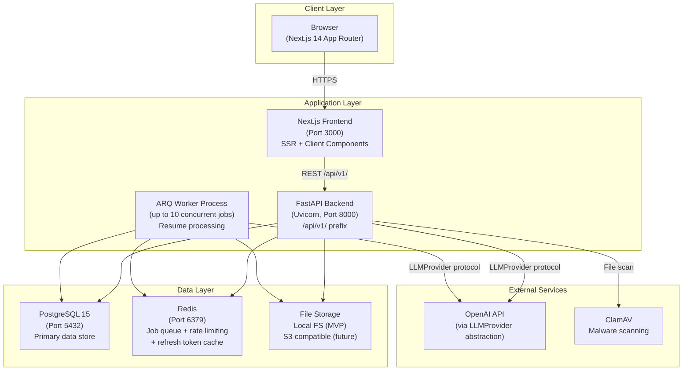
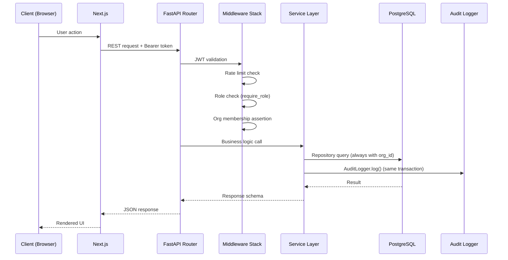
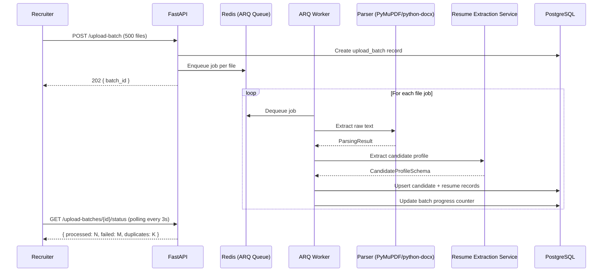
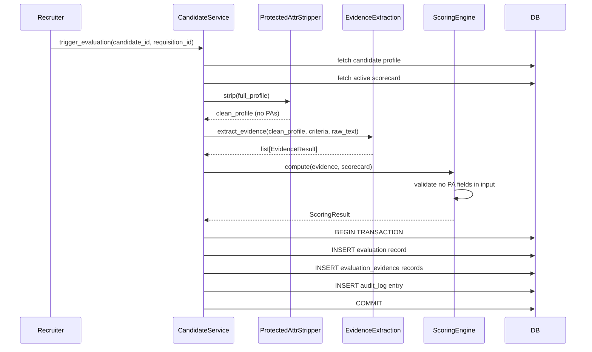
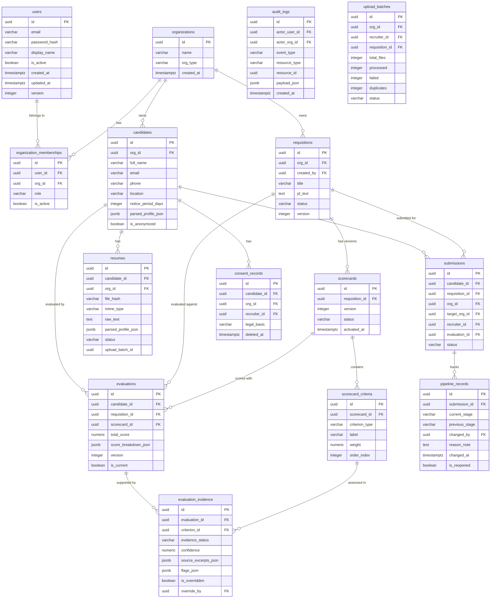
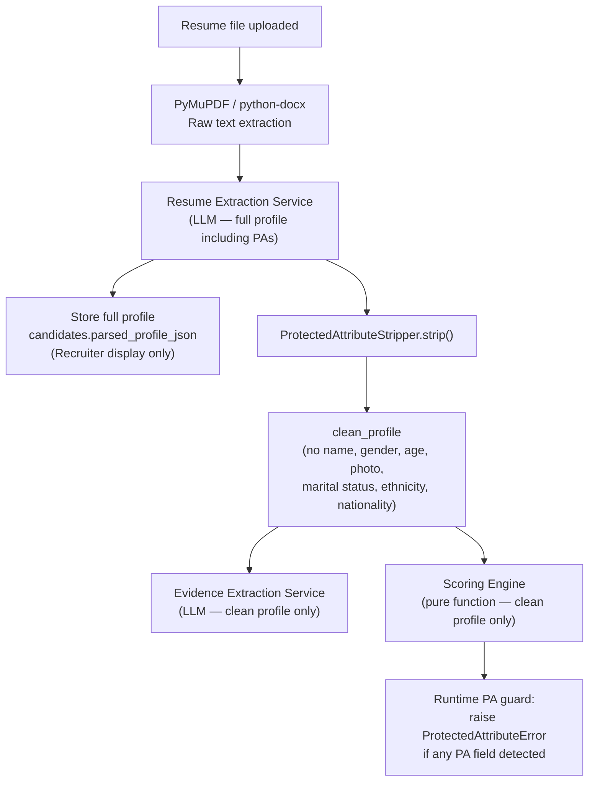
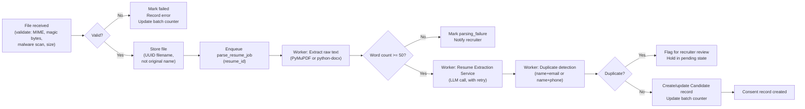
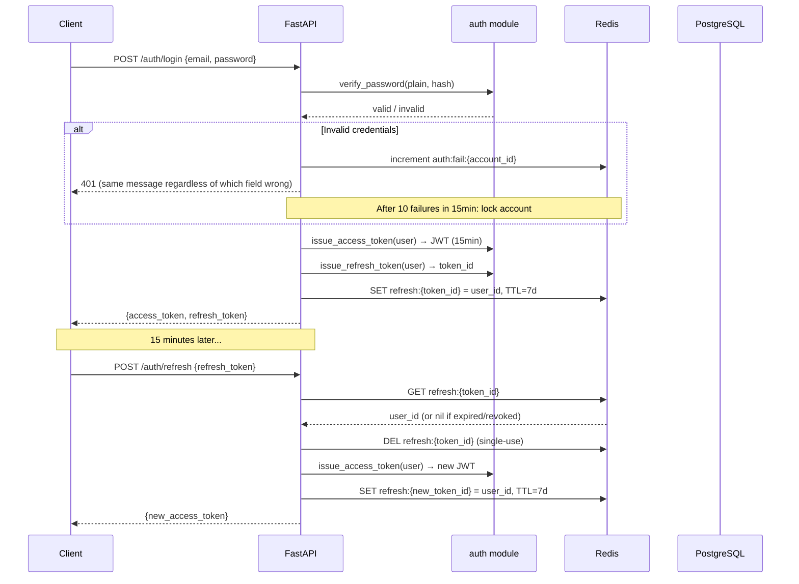

# Design Document — ShortlistAI

## Overview

ShortlistAI is an evidence-based AI resume screening and client shortlist platform for staffing and recruitment firms. It enables recruiters to create job requisitions, extract structured requirements from job descriptions via AI, bulk-upload candidate resumes, evaluate candidates against configurable scorecards using a deterministic scoring engine, and submit shortlists to client hiring managers — all while maintaining responsible AI principles, multi-tenant data isolation, and full audit traceability.

### Modular Monolith Rationale

ShortlistAI is structured as a **modular monolith**: a single deployable unit whose internal structure is organized into clearly bounded modules with explicit interfaces. This choice is deliberate for an early-stage product:

- **Operational simplicity**: One backend process, one worker process. No distributed tracing, no service mesh, no inter-service networking.
- **Transactional integrity**: Multi-step operations (create evaluation + store evidence + write audit log) execute in a single database transaction, which is trivially correct in a monolith and requires distributed sagas in microservices.
- **Future optionality**: Each module's interface contracts are already defined. If a module (e.g., `ai/`) needs to scale independently, it can be extracted into a service without rewriting business logic.
- **Team scale fit**: A single team can own the entire codebase without coordination overhead.

The tradeoff is that all modules share a process and database. This is appropriate for the current scale (hundreds of organizations, thousands of candidates per organization).

---

## Architecture

### Deployment Topology



### Request Lifecycle



### Background Job Processing Flow



---

## Components and Interfaces

### Backend Module Structure

```
backend/app/
├── api/v1/                     # FastAPI routers (thin — delegate to services)
│   ├── auth.py
│   ├── requisitions.py
│   ├── scorecards.py
│   ├── resumes.py
│   ├── candidates.py
│   ├── submissions.py
│   ├── pipeline.py
│   ├── analytics.py
│   ├── audit.py
│   └── account.py
├── core/                       # Shared infrastructure
│   ├── config.py               # Pydantic BaseSettings — all env vars
│   ├── database.py             # Async SQLAlchemy engine + session factory
│   ├── base_model.py           # UUID PK, created_at, updated_at
│   └── dependencies.py         # get_db, get_current_user, require_role
├── auth/                       # Token lifecycle, password, RBAC, rate limiting
│   ├── hashing.py
│   ├── jwt.py
│   ├── refresh_tokens.py
│   ├── rbac.py
│   └── rate_limiter.py
├── organizations/              # Org CRUD, membership, cross-org guard
│   ├── models.py
│   ├── schemas.py
│   ├── repository.py
│   └── service.py
├── requisitions/               # Requisition CRUD, search, optimistic locking
│   ├── models.py
│   ├── schemas.py
│   ├── repository.py
│   └── service.py
├── scorecards/                 # Scorecard + criteria management, versioning
│   ├── models.py
│   ├── schemas.py
│   ├── repository.py
│   └── service.py
├── resumes/                    # File upload, validation, storage, dedup
│   ├── models.py
│   ├── schemas.py
│   ├── repository.py
│   ├── service.py
│   ├── storage.py              # StorageBackend protocol + LocalFSBackend
│   └── validator.py            # MIME + magic bytes + malware scan
├── parsing/                    # Pure text extraction — no AI
│   ├── pdf_parser.py           # PyMuPDF (fitz)
│   ├── docx_parser.py          # python-docx
│   └── parsing_result.py
├── ai/                         # LLM abstraction + three extraction services
│   ├── provider.py             # LLMProvider protocol (typing.Protocol)
│   ├── provider_factory.py     # Dynamic loading from config
│   ├── openai_provider.py      # Concrete OpenAI implementation
│   ├── jd_extraction.py        # JDExtractionService
│   ├── resume_extraction.py    # ResumeExtractionService
│   ├── evidence_extraction.py  # EvidenceExtractionService
│   ├── schemas.py              # Shared AI schema types
│   └── protected_attrs.py      # ProtectedAttributeStripper
├── scoring/                    # Deterministic scoring engine — pure function
│   ├── engine.py               # ScoringEngine.compute()
│   ├── schemas.py              # ScoringInput, ScoringResult
│   └── rules.py                # Scoring rule constants
├── candidates/                 # Candidate profile, evaluation orchestration
│   ├── models.py
│   ├── schemas.py
│   ├── repository.py
│   └── service.py
├── submissions/                # Shortlisting, submission, contact masking
│   ├── models.py
│   ├── schemas.py
│   ├── repository.py
│   └── service.py
├── pipeline/                   # Stage tracking, transition validation
│   ├── models.py
│   ├── schemas.py
│   ├── repository.py
│   └── service.py
├── audit/                      # Append-only audit log
│   ├── models.py
│   ├── schemas.py
│   ├── repository.py
│   └── logger.py               # AuditLogger.log()
├── privacy/                    # Consent records, PII anonymization
│   ├── models.py
│   ├── schemas.py
│   └── service.py
├── bias/                       # Rank correlation, alerts, reports
│   ├── service.py
│   └── schemas.py
├── notifications/              # In-app notifications
│   ├── models.py
│   └── service.py
└── jobs/                       # ARQ job definitions + worker config
    ├── worker.py
    ├── resume_jobs.py
    └── evaluation_jobs.py
```

### Key Module Interfaces

#### `core/dependencies.py`

```python
async def get_db() -> AsyncSession: ...          # SQLAlchemy async session per request
async def get_current_user(token: str) -> CurrentUser: ...
def require_role(*roles: str) -> Depends: ...    # Raises 403 if role not in roles
```

#### `auth/` — Token and Security

```python
class PasswordHasher:
    def hash(self, plain: str) -> str: ...
    def verify(self, plain: str, hashed: str) -> bool: ...

class JWTManager:
    def issue_access_token(self, user: User) -> str: ...        # 15 min expiry
    def issue_refresh_token(self, user: User) -> RefreshToken: ...
    def decode_access_token(self, token: str) -> TokenPayload: ...
    def revoke_refresh_token(self, token_id: str) -> None: ...

class RateLimiter:
    async def check_and_increment(self, key: str) -> RateLimitResult: ...
    async def is_locked(self, account_id: str) -> bool: ...
```

#### `ai/provider.py` — LLM Provider Protocol

```python
from typing import Protocol, Any

class LLMProvider(Protocol):
    async def extract_jd(
        self,
        prompt: str,
        output_schema: dict[str, Any],
        max_tokens: int,
    ) -> dict[str, Any]: ...

    async def extract_resume(
        self,
        prompt: str,
        output_schema: dict[str, Any],
        max_tokens: int,
    ) -> dict[str, Any]: ...

    async def extract_evidence(
        self,
        prompt: str,
        output_schema: dict[str, Any],
        max_tokens: int,
    ) -> dict[str, Any]: ...
```

#### `scoring/engine.py` — Deterministic Scoring Engine

```python
class ScoringEngine:
    def compute(
        self,
        evidence: list[EvidenceResult],
        scorecard: ScorecardSchema,
    ) -> ScoringResult:
        """
        Pure function — no I/O, no LLM, no randomness.
        Raises ProtectedAttributeError if any PA field detected in input.
        """
        ...
```

#### `audit/logger.py` — Audit Logger

```python
class AuditLogger:
    async def log(
        self,
        event_type: str,
        actor_user_id: UUID,
        actor_org_id: UUID,
        resource_type: str,
        resource_id: UUID,
        payload: dict,
        session: AsyncSession,    # always same transaction as caller
    ) -> None:
        """
        If this insert fails, raises exception → caller's transaction rolls back.
        No operation proceeds without its audit log entry.
        """
        ...
```

#### `submissions/service.py` — Contact Masking and Profile View Gate

```python
class ProfileViewGate:
    async def assert_viewed(
        self,
        recruiter_id: UUID,
        candidate_id: UUID,
        requisition_id: UUID,
    ) -> None:
        """Raises ForbiddenError if no CANDIDATE_PROFILE_VIEWED audit entry found."""
        ...

class ContactMasker:
    def mask(self, profile: CandidateProfile) -> MaskedCandidateProfile:
        """Sets email, phone, address to None. Applied at service layer, not API layer."""
        ...
```

### Frontend Module Structure

```
frontend/
├── app/
│   ├── (auth)/
│   │   └── login/
│   │       └── page.tsx
│   ├── (recruiter)/
│   │   ├── dashboard/
│   │   │   └── page.tsx                    # SSR dashboard
│   │   ├── requisitions/
│   │   │   ├── page.tsx                    # List requisitions
│   │   │   ├── new/page.tsx                # Create requisition
│   │   │   └── [id]/
│   │   │       ├── page.tsx                # Requisition detail
│   │   │       ├── scorecard/page.tsx      # Scorecard editor
│   │   │       └── candidates/
│   │   │           ├── page.tsx            # Ranked candidate list
│   │   │           └── [candidateId]/page.tsx  # Candidate profile
│   │   ├── upload/
│   │   │   └── [requisitionId]/page.tsx    # Bulk upload screen
│   │   └── pipeline/
│   │       └── page.tsx                    # Pipeline tracker
│   ├── (client)/
│   │   ├── portal/
│   │   │   └── page.tsx                    # Client hiring manager portal
│   │   └── candidates/
│   │       └── [id]/page.tsx               # Client candidate view (masked)
│   ├── (delivery)/
│   │   ├── analytics/
│   │   │   └── page.tsx                    # Pipeline analytics
│   │   └── bias-monitor/
│   │       └── page.tsx                    # Bias monitoring report
│   └── account/
│       └── page.tsx                        # Account settings + privacy
├── components/
│   ├── ui/                                 # shadcn/ui re-exports + custom
│   ├── scorecard/
│   │   ├── ScorecardEditor.tsx
│   │   ├── CriterionRow.tsx
│   │   └── WeightSummary.tsx
│   ├── candidates/
│   │   ├── CandidateCard.tsx
│   │   ├── CandidateList.tsx
│   │   ├── EvidenceBreakdown.tsx
│   │   ├── ScoreBreakdownChart.tsx
│   │   └── ProfileViewGate.tsx
│   ├── upload/
│   │   ├── DropZone.tsx
│   │   ├── FileStatusList.tsx
│   │   ├── BatchProgressBar.tsx
│   │   └── DuplicateResolver.tsx
│   ├── pipeline/
│   │   ├── PipelineBoard.tsx
│   │   └── StageTransitionModal.tsx
│   └── charts/
│       ├── FunnelChart.tsx
│       ├── BarChart.tsx
│       └── LineChart.tsx
├── lib/
│   ├── api.ts                              # Typed API client (fetch wrapper)
│   ├── auth.ts                             # Token management, session
│   └── types.ts                            # Shared TypeScript types
└── hooks/
    ├── useUploadBatchPolling.ts            # Poll /upload-batches/{id}/status
    ├── useCandidateFilters.ts              # Filter state management
    └── usePipelineStage.ts
```

### Component Interaction: Evaluation Flow



---

## Data Models

### Entity Relationship Overview



### Key Data Model Decisions

**Scorecard Versioning**: When a recruiter resets an active scorecard to draft, a new version is created (`CREATE_NEW_DRAFT_FROM_ACTIVE`). Historical evaluation records retain a foreign key to the exact scorecard version that was active at evaluation time. The `evaluations.scorecard_id` field provides this traceability.

**Evaluation Versioning**: Evidence overrides create a new evaluation version (`version` incremented, `is_current = true` on new, `is_current = false` on prior). Queries for "current" evaluation always filter `WHERE is_current = true`.

**Protected Attribute Storage**: The full extracted profile including protected attributes is stored in `candidates.parsed_profile_json` for Recruiter display. A separate, stripped version is passed at runtime to evidence extraction and scoring. No protected attribute values are stored in `evaluations` or `evaluation_evidence`.

**Audit Log Immutability**: The application database user is granted `INSERT` only on `audit_logs`. No `UPDATE` or `DELETE` permission is granted. This is enforced at the database permission layer, not just the application layer.

**Tenant Isolation at Query Layer**: Every repository function accepts `org_id` as a required parameter and always includes `WHERE org_id = :org_id` in queries. There is no application-layer bypass available.

---

## API Design

### Base URL and Versioning

All endpoints are prefixed with `/api/v1/`. Future breaking changes increment to `/api/v2/`.

### Standard Response Envelope

Success responses return data directly at the top level (or as `items` + pagination metadata for lists). Error responses always use:

```json
{
  "error_code": "VALIDATION_ERROR",
  "message": "Human-readable description",
  "trace_id": "req-abc123def456",
  "details": [
    { "field": "email", "issue": "Field is required" }
  ]
}
```

### Pagination Convention

```
GET /api/v1/requisitions?page=1&page_size=20&sort_by=created_at&sort_dir=desc
```

Response:
```json
{
  "items": [...],
  "total": 142,
  "page": 1,
  "page_size": 20
}
```

### Key Endpoint Groups

| Group | Endpoints | Roles |
|-------|-----------|-------|
| Auth | `POST /auth/login`, `/auth/refresh`, `/auth/logout` | Public / Any |
| Requisitions | `GET/POST /requisitions`, `GET/PUT/DELETE /requisitions/{id}` | Recruiter, Delivery_Head |
| JD Extraction | `POST /requisitions/{id}/extract-jd` | Recruiter |
| Scorecards | `GET/POST /requisitions/{id}/scorecards`, `PUT /scorecards/{id}` | Recruiter |
| Upload | `POST /requisitions/{id}/upload-batch`, `GET /upload-batches/{id}/status` | Recruiter |
| Candidates | `GET /requisitions/{id}/candidates`, `GET /candidates/{id}` | Recruiter, Delivery_Head |
| Evaluation | `POST /candidates/{id}/evaluate`, `POST /candidates/{id}/override-evidence` | Recruiter |
| Submissions | `POST /requisitions/{id}/submissions`, `DELETE /submissions/{id}` | Recruiter |
| Client Portal | `GET /client/submissions`, `POST /pipeline/{id}/stages` | Client_Hiring_Manager |
| Pipeline | `GET/POST /pipeline/{submission_id}/stages` | Recruiter, Client_HM |
| Analytics | `GET /analytics/pipeline`, `GET /analytics/bias` | Delivery_Head |
| Audit | `GET /audit-logs` | Delivery_Head |
| Account | `GET/PUT /account/me`, `GET /account/activity` | Any |

### HTTP Status Code Conventions

| Code | When Used |
|------|-----------|
| 200 | Successful read or update |
| 201 | Resource created |
| 202 | Async job accepted |
| 204 | Successful delete/void |
| 400 | Business rule violation (invalid weights, missing reason_note) |
| 401 | Missing or invalid JWT |
| 403 | Valid JWT but wrong role |
| 404 | Resource not found (also used for cross-org access to prevent existence disclosure) |
| 409 | Optimistic lock conflict |
| 413 | File/batch too large |
| 415 | Unsupported file type |
| 422 | Pydantic schema validation failure |
| 429 | Rate limit exceeded |
| 503 | LLM provider unavailable after retries |

---

## AI Service Designs

### LLM Provider Abstraction

All AI calls are mediated through the `LLMProvider` protocol. Provider selection is purely configuration-driven:

```python
# core/config.py
class Config(BaseSettings):
    LLM_PROVIDER: str = "openai"      # from environment variable
    OPENAI_API_KEY: str               # from environment variable
    OPENAI_MODEL: str = "gpt-4o"

# ai/provider_factory.py
def get_llm_provider(config: Config) -> LLMProvider:
    providers = {
        "openai": OpenAIProvider,
        # "anthropic": AnthropicProvider,  # future
    }
    cls = providers.get(config.LLM_PROVIDER)
    if cls is None:
        raise ValueError(f"Unknown provider: {config.LLM_PROVIDER}")
    return cls(config)
```

Every LLM call logs: provider name, model version, service name, prompt tokens, completion tokens — all to the audit log.

### LLM Retry Policy

```
Retryable errors (up to 3 attempts, exponential backoff: 1s, 2s, 4s):
  - RateLimitError
  - NetworkError / TimeoutError

Non-retryable errors (fail immediately, no retry):
  - JSON parse error from LLM response
  - Pydantic schema validation failure on response
  - AuthenticationError
  - Any other provider-side error
```

### Token Budget (configurable per service)

| Service | Max Input Tokens | Max Output Tokens |
|---------|----------------|-------------------|
| JD Extraction | 4,000 | 1,000 |
| Resume Extraction | 8,000 | 2,000 |
| Evidence Extraction | 10,000 | 3,000 |

### JD Extraction Service

**Input**: `jd_text: str` (the job description free text)

**Output**: `JDExtractionResult` — structured fields each with `value` and `confidence` (0.0–1.0):

```python
class JDExtractionResult(BaseModel):
    job_title: FieldWithConfidence[str]
    experience_range: FieldWithConfidence[ExperienceRange]
    location: FieldWithConfidence[str]
    must_have_skills: list[FieldWithConfidence[str]]
    nice_to_have_skills: list[FieldWithConfidence[str]]
    notice_period: FieldWithConfidence[str]
    other_requirements: list[FieldWithConfidence[str]]
    raw_llm_response_json: str        # stored for audit

class FieldWithConfidence(BaseModel, Generic[T]):
    value: T | None    # null if not found in JD
    confidence: float  # 0.0 if null, 0.0–1.0 if present
```

**Critical constraint**: Must-have skills list contains **only** skills explicitly present in the JD text. The LLM prompt explicitly prohibits inference. Post-extraction validation can spot-check by requiring each skill to appear as a substring of the JD.

**Null handling**: If a field cannot be extracted: `value = null`, `confidence = 0.0`. No fabrication.

### Resume Extraction Service

**Input**: `raw_text: str` (pre-extracted by PyMuPDF or python-docx)

**Output**: `CandidateProfileSchema` — structured candidate data with per-field confidence:

```python
class CandidateProfileSchema(BaseModel):
    # Protected — retained for Recruiter display; never sent to scoring/evidence
    full_name: FieldWithConfidence[str]

    # Non-protected — used in scoring pipeline
    location: FieldWithConfidence[str]
    total_years_experience: FieldWithConfidence[float]
    notice_period_days: FieldWithConfidence[int]
    skills: list[FieldWithConfidence[str]]
    employment_history: list[EmploymentRecord]
    education: list[EducationRecord]
```

**Failure condition**: If word count of `raw_text < 50`, the resume is marked as `parsing_failure`. The recruiter is notified. Raw text is stored regardless (enables re-extraction without re-upload). Successful resumes do not trigger a notification.

### Evidence Extraction Service

**Input**:
- `clean_profile: dict` — candidate profile with all protected attributes stripped
- `criteria: list[ScorecardCriterion]` — the criteria to assess
- `raw_text: str` — original resume text (used only for excerpt verification)

**Output**: `list[EvidenceResult]` — one per criterion:

```python
class EvidenceResult(BaseModel):
    criterion_id: UUID
    criterion_label: str
    evidence_status: Literal["matched", "not_matched", "unknown", "insufficient_evidence"]
    confidence: float               # 0.0–1.0
    source_excerpts: list[str]      # verbatim from resume; required for matched/not_matched
    flags: EvidenceFlags

class EvidenceFlags(BaseModel):
    low_confidence: bool    # True if confidence < 0.5
    conflict: bool          # True if conflicting evidence found
```

**Evidence status semantics**:

| Status | Meaning | Scoring treatment |
|--------|---------|------------------|
| `matched` | Criterion clearly satisfied | Full points |
| `not_matched` | Criterion clearly not satisfied | Zero points |
| `unknown` | Resume lacks relevant information | 50% of points |
| `insufficient_evidence` | Some evidence present but inconclusive | 50% of points |

**Anti-fabrication validation**: After extraction, each excerpt in `source_excerpts` is validated as a substring (or near-verbatim match with ≥ 80% token overlap) of the original `raw_text`. Any excerpt failing this check causes the criterion to be marked `insufficient_evidence` and flagged.

**Protected attribute guard**: The service rejects inputs where `clean_profile` contains any protected attribute field names. The `ProtectedAttributeStripper` runs before this service is called, but the service applies its own runtime check as a defense-in-depth measure.

### Protected Attribute Pipeline



---

## Scoring Engine Algorithm

The Scoring Engine is the most critical component for transparency. It is a **pure function** — no I/O, no LLM calls, no external state, no randomness. Given the same evidence and scorecard inputs, it always produces the same output.

### Algorithm Specification

```
Input:
  - evidence: list[EvidenceResult]      (one per scorecard criterion)
  - scorecard: ScorecardSchema          (criteria with weights; sum = 100)

Pre-condition check:
  - Iterate over all input field names
  - IF any protected attribute field name found → raise ProtectedAttributeError immediately

For each criterion C in scorecard.criteria:
  
  Step 1: Base point allocation
    IF evidence[C].status == "matched":
        base = C.weight
    ELIF evidence[C].status == "not_matched":
        base = 0.0
    ELIF evidence[C].status in ("unknown", "insufficient_evidence"):
        base = C.weight × 0.5
        set unknown_flag = True

  Step 2: Confidence penalty
    IF evidence[C].confidence < 0.5:
        penalized = base × 0.75    (apply 25% penalty)
        set low_confidence_flag = True
    ELSE:
        penalized = base

  Step 3: Conflict handling
    IF evidence[C].flags.conflict == True:
        Use lower conflicting value for numeric criteria
        set conflict_flag = True

  Step 4: Must-have skill override (applies to all must_have_skill criteria together)
    must_have_criteria = [c for c in scorecard.criteria where c.type == "must_have_skill"]
    IF must_have_criteria is not empty:
        matched_count = count of must-have criteria with status == "matched"
        total_count = len(must_have_criteria)
        must_have_total_weight = sum(c.weight for c in must_have_criteria)
        must_have_points = (matched_count / total_count) × must_have_total_weight
        
        Note: This proportional formula replaces Step 1 for must-have skills.
        Individual criterion allocations from Step 1 are preserved for display only.

  Record per-criterion output:
    CriterionScore {
        criterion_id, criterion_label,
        max_points = C.weight,
        awarded_points = penalized (or must_have_points for must-have category),
        evidence_status, confidence,
        low_confidence_flag, conflict_flag, penalty_applied
    }

Final computation:
  total_score = sum(cs.awarded_points for cs in criterion_scores)
  total_score = clamp(total_score, 0.0, 100.0)

Output:
  ScoringResult {
      total_score: float [0.0, 100.0],
      criterion_scores: list[CriterionScore]
  }
```

### Scoring Example

Given scorecard: experience (30), must_have_skills: Python (20), FastAPI (20), notice_period (15), location (10), nice_to_have: Kubernetes (5):

| Criterion | Status | Confidence | Base | After Penalty | Notes |
|-----------|--------|-----------|------|---------------|-------|
| Experience | matched | 0.88 | 30.0 | 30.0 | — |
| Python (must_have) | matched | 0.94 | — | — | Proportional formula |
| FastAPI (must_have) | unknown | 0.42 | — | — | Proportional formula |
| Notice period | matched | 0.85 | 15.0 | 15.0 | — |
| Location | not_matched | 0.91 | 0.0 | 0.0 | — |
| Kubernetes | matched | 0.76 | 5.0 | 5.0 | |

Must-have: matched_count=1, total=2, weight_total=40 → 1/2 × 40 = **20.0**

Total: 30 + 20 + 15 + 0 + 5 = **70.0**

---

## Background Job Processing

### Architecture

ARQ (Async Redis Queue) is used for all background processing. Each file in a bulk upload batch is processed as an independent job. This provides:

- **Fault isolation**: One corrupt file does not block others
- **Retry semantics**: Individual job retries without re-processing the entire batch
- **Concurrency**: Up to 10 jobs run simultaneously per worker process
- **Progress tracking**: Batch counters updated atomically after each job

### Job Pipeline per Resume File



### Retry Policy

```
Retry conditions (up to 3 attempts, exponential backoff: 1s → 2s → 4s):
  - LLM rate limit or network timeout
  - Transient DB connection errors

Permanent failure (no retry):
  - Corrupt or unreadable file content
  - Unsupported encoding
  - LLM response schema validation failure
  - Malware detected

After 3 retries exhausted → mark file as permanently failed, record error reason
```

### Deduplication

Before enqueueing, a SHA-256 hash of the file content is computed. If a resume with that hash already exists in the `resumes` table, the job is not enqueued (idempotency). Identity-level deduplication (name+email or name+phone) is performed during processing to handle the same candidate submitted with a modified resume.

### Batch Status Polling

The frontend polls `GET /upload-batches/{id}/status` every 3 seconds. The endpoint reads from the `upload_batches` table which is updated atomically by workers. This avoids SSE complexity for the MVP while staying within the 5-second progress update SLA.

### Graceful Shutdown

ARQ workers listen for `SIGTERM`. In-progress jobs are completed before the process exits. Queued jobs remain in Redis and are picked up on next startup.

---

## Security Architecture

### Authentication Flow



### File Upload Security Pipeline

Every uploaded file passes all five checks sequentially. Failure at any step rejects the file:

```
1. Extension check     → .pdf or .docx only
2. MIME type header    → Content-Type must match PDF or DOCX MIME type
3. Magic bytes check   → %PDF- prefix for PDF; PK\x03\x04 for DOCX (ZIP-based)
4. Size check          → max 10 MB per file, max 1 GB per batch (or 500 files)
5. Malware scan        → ClamAV signature scan; quarantine on detection
```

Files are stored with UUID-based names (never the original filename) in a directory that is not web-accessible. File paths are constructed using `pathlib.Path`, not string interpolation.

### Security Headers

Applied via FastAPI middleware on every response. All five headers are required — absence of any one is a compliance violation:

| Header | Value |
|--------|-------|
| `Content-Security-Policy` | `default-src 'self'; script-src 'self'; style-src 'self' 'unsafe-inline'` |
| `X-Frame-Options` | `DENY` |
| `X-Content-Type-Options` | `nosniff` |
| `Strict-Transport-Security` | `max-age=31536000; includeSubDomains` |
| `Referrer-Policy` | `strict-origin-when-cross-origin` |

### Rate Limiting

All limits enforced using Redis sliding-window counters:

| Endpoint | Limit | Window |
|----------|-------|--------|
| `POST /auth/login` | 10 requests/IP | 1 minute |
| Auth failures per account | 10 failures | 15 minutes → lock |
| File upload endpoints | 5 uploads/user | 1 minute |
| All other API endpoints | 100 requests/user | 1 minute |

### Multi-Tenant Isolation Enforcement

Isolation is enforced at three independent layers (defense in depth):

1. **Repository layer**: Every query includes `WHERE org_id = :org_id` — injected from the authenticated user's token claims
2. **Service layer**: `assert_org_member(user_id, org_id)` runs before any operation
3. **Cross-org access logging**: `CROSS_ORG_ACCESS_ATTEMPT` audit event is written and a 404 is returned (not 403 — to avoid revealing resource existence)

### Contact Masking

Applied at the service layer, not only in the API serializer:

```python
MASKED_FIELDS = {"email", "phone", "address", "home_address"}

def mask_contact_info(profile: CandidateProfile, role: str) -> dict:
    if role == "client_hiring_manager":
        return {k: None if k in MASKED_FIELDS else v
                for k, v in profile.dict().items()}
    return profile.dict()
```

This ensures masked fields never appear in any client-org response, regardless of code path.

---

## Frontend Architecture

### Rendering Strategy

| Page | Rendering | Rationale |
|------|-----------|-----------|
| Dashboard | SSR (Next.js App Router) | SEO not needed; initial load performance |
| Candidate list | SSR + Client hydration | Fast first paint; filter updates client-side |
| Candidate profile | SSR | Stable data; 2s render SLA |
| Upload screen | CSR | Entirely interactive; no crawlability needed |
| Client portal | SSR | Fresh data on load; client-side actions |
| Analytics | CSR | Dynamic charts; filtered queries |

### State Management

No global state manager (Redux/Zustand) for MVP. State is managed at:
- **URL params**: Filter state (score_min, skills, pipeline_stage) — survives navigation
- **React state + useEffect**: Upload batch polling, form state
- **Server state**: React Server Components for SSR pages
- **Custom hooks**: `useUploadBatchPolling`, `useCandidateFilters`

Filter state persists across navigation by encoding it into the URL query string. Returning to the candidate list restores the previous filter configuration.

### API Client

A typed fetch wrapper in `lib/api.ts` handles:
- Automatic `Authorization: Bearer` header injection
- Transparent access token refresh on 401 (retry original request once)
- Standardized error parsing from the error envelope
- TypeScript response types generated from OpenAPI schema

### Component Hierarchy — Key Screens

**Candidate Profile Screen**:
```
CandidateProfilePage
├── ProfileHeader (name, score badge, AI label)
├── ScoreBreakdownChart (per-criterion bar chart)
├── EvidenceBreakdown
│   └── CriterionRow (for each criterion)
│       ├── StatusBadge (matched / not_matched / unknown / insufficient)
│       ├── ConfidenceIndicator
│       ├── FlagBadges (low_confidence, conflict)
│       └── SourceExcerptExpander
├── ResumeViewer (PDF render or extracted text)
├── OverridePanel (if Recruiter role)
│   └── OverrideReasonModal
└── RecruiterNotesList
    └── NoteEditor
```

**Bulk Upload Screen**:
```
UploadPage
├── DropZone (accepts PDF, DOCX)
├── BatchProgressBar (total / success / failed / duplicate)
├── FileStatusList
│   └── FileStatusRow (file name, status badge, hover: failure reason)
├── DuplicateResolver (side-by-side comparison modal)
└── DownloadCSVButton (post-completion)
```

### Accessibility

All interactive components use shadcn/ui primitives which include ARIA roles and keyboard navigation. The AI content label uses `aria-label` to communicate the AI-generated nature to screen readers. Score badges and status indicators use color plus icon to avoid relying on color alone (WCAG 1.4.1).

---

## Error Handling

### Error Categories and Handling

| Category | HTTP Status | Backend Behavior | Frontend Behavior |
|----------|------------|-----------------|-------------------|
| Schema validation | 422 | FastAPI auto-response via Pydantic | Field-level error display |
| Authentication | 401 | Uniform message (no field disclosure) | Redirect to login |
| Authorization | 403 | Log attempt + return forbidden | Show permission error |
| Cross-org access | 404 | Log + return not found | Standard 404 page |
| Optimistic lock | 409 | Return conflict with current version | Reload and retry prompt |
| LLM unavailable | 503 | After 3 retries with backoff | "AI service temporarily unavailable" banner |
| File validation | 400/413/415 | Per-file descriptive error | Inline file error in upload list |
| Malware detected | 400 | Quarantine + audit log | Security alert to recruiter |
| Audit log failure | 500 | Transaction rollback | Generic error; operation not applied |

### Audit Log as Transaction Guard

If the audit log write fails, the entire operation transaction rolls back. This guarantees there is never an unlogged state change in the system. This is a deliberate design choice: auditability is a hard invariant, not a best-effort side effect.

### LLM Failure Handling

When an LLM extraction fails after all retries:
- The resume is marked with `status = "failed"` and `failure_reason` recorded
- The upload batch counters are updated (increments `failed`)
- The recruiter is notified via in-app notification
- Raw text is retained in the `resumes` table to allow re-extraction without re-upload
- The batch continues processing remaining files

### Background Job Error Propagation

Job errors are captured by ARQ's exception handler. Non-retryable errors mark the job as `permanently_failed`. Retryable errors are re-queued with exponential backoff. The `upload_batches` table is the source of truth for batch status — the frontend polls this, not Redis directly.

---

## Correctness Properties

*A property is a characteristic or behavior that should hold true across all valid executions of a system — essentially, a formal statement about what the system should do. Properties serve as the bridge between human-readable specifications and machine-verifiable correctness guarantees.*

The following properties are implemented using [Hypothesis](https://hypothesis.readthedocs.io/) (Python property-based testing library) with a minimum of 100 iterations each.

---

### Property 1: Scoring Engine — Score Invariant

*For any* valid combination of evidence results and scorecard configuration, the total score computed by the Scoring Engine shall always be within the range [0.0, 100.0].

**Validates: Requirements 10.1**

---

### Property 2: Scoring Engine — Determinism

*For any* valid evidence list and scorecard, computing the score twice with identical inputs always produces bit-for-bit identical `ScoringResult` outputs (total score and all per-criterion breakdowns).

**Validates: Requirements 10.9**

---

### Property 3: Scoring Engine — Unknown/Insufficient Evidence Partial Credit

*For any* scorecard where at least one criterion has status `unknown` or `insufficient_evidence`, the awarded points for that criterion shall always be strictly greater than 0.0 and strictly less than the criterion's full weight allocation (i.e., exactly 50% before any confidence penalty, and 37.5% with the confidence penalty applied when confidence < 0.5).

**Validates: Requirements 10.4, 10.5**

---

### Property 4: Scoring Engine — Protected Attribute Guard

*For any* scoring input dict that contains one or more protected attribute field names (name, gender, age, date_of_birth, photograph, marital_status, ethnicity, nationality), the Scoring Engine shall always raise `ProtectedAttributeError` and never return a score.

**Validates: Requirements 10.11, 16.3**

---

### Property 5: Scoring Engine — Must-Have Proportional Formula

*For any* scorecard with N must-have skill criteria of total weight W, where M of those criteria have status `matched`, the points awarded for the must-have category shall always equal exactly `(M / N) × W`, regardless of individual criterion weights.

**Validates: Requirements 10.7**

---

### Property 6: Protected Attribute Stripping

*For any* candidate profile JSON containing any combination of protected attribute fields, the output of `ProtectedAttributeStripper.strip()` shall contain none of the protected attribute field names, and all non-protected fields shall be present and unchanged.

**Validates: Requirements 8.5, 16.2**

---

### Property 7: Extraction Confidence Score Range

*For any* extraction result from the JD Extraction Service or Resume Extraction Service, all confidence scores in the result shall always be within [0.0, 1.0], and any field with a null value shall always have a confidence score of exactly 0.0.

**Validates: Requirements 5.2, 5.3, 8.2, 8.3**

---

### Property 8: Multi-Tenant Isolation

*For any* two organizations A and B with distinct candidate, requisition, and evaluation records, a user authenticated as a member of organization A shall never receive any records belonging to organization B in any API response, regardless of query parameters.

**Validates: Requirements 2.2, 2.3**

---

### Property 9: RBAC Enforcement — Forbidden Endpoints Always Rejected

*For any* (user_role, restricted_endpoint) pair where the role lacks permission, the API shall always return HTTP 403, and an audit log entry with event type `UNAUTHORIZED_ACCESS_ATTEMPT` shall always be created.

**Validates: Requirements 3.9**

---

### Property 10: Authentication Error Non-Disclosure

*For any* login attempt with invalid credentials — whether the email does not exist or the password is wrong — the error response body shall always be identical, revealing no information about which field was incorrect.

**Validates: Requirements 1.3**

---

### Property 11: Audit Log Atomicity

*For any* auditable operation (requisition create, submission create, pipeline stage change, etc.) where the audit log write is forced to fail via injection, the triggering operation shall also fail and the target resource shall remain in its pre-operation state.

**Validates: Requirements 18.6**

---

### Property 12: Bulk Submission Batch Size Invariant

*For any* submission request containing more than 50 candidate IDs, the request shall always be rejected entirely with a 400 error. *For any* submission request containing 50 or fewer candidate IDs (given all other preconditions are met), the request shall always succeed.

**Validates: Requirements 13.8**

---

### Property 13: Pipeline Stage Reversion Requires Reason Note

*For any* pipeline stage reversion attempt — by any actor in any role — where the `reason_note` field is absent or empty, the request shall always be rejected with a 400 error and no stage change shall be recorded.

**Validates: Requirements 15.4**

---

### Property 14: Data Deletion Anonymization Invariant

*For any* candidate record after the anonymization workflow completes, the invariant holds: all PII fields (full_name, email, phone, location) are null or set to `[ANONYMIZED]`; evaluation score records for that candidate are still present and non-null; at least one `DATA_DELETION_COMPLETED` audit log entry exists for that candidate.

**Validates: Requirements 19.2**

---

### Property 15: Submission Requires Profile View

*For any* candidate where no `CANDIDATE_PROFILE_VIEWED` audit log entry exists for the submitting recruiter against that candidate in that requisition context, a submission attempt by that recruiter shall always be rejected.

**Validates: Requirements 13.2**

---

## Testing Strategy

### Dual Testing Approach

The test suite uses both property-based testing and example-based unit tests, treating them as complementary:

- **Property tests (Hypothesis)**: Validate universal invariants across many generated inputs. Minimum 100 iterations per property. Used for the Scoring Engine, PA stripping, extraction schemas, RBAC, multi-tenant isolation, and other logic-heavy components.
- **Unit tests (Pytest)**: Validate specific behaviors with concrete examples. Used for authentication flows, file validation logic, individual scoring rule spot-checks, and API response shapes.
- **Integration tests (Pytest + TestClient)**: Test full request–response cycles against a real test database. Cover all critical API endpoints.
- **E2E tests (Playwright)**: Cover the critical Recruiter path end-to-end: login → create requisition → upload resume → view evaluation → shortlist → submit to client. Each step has an individual test AND there is a combined path test asserting successful conjunction.

### Test Organization

```
tests/
├── unit/
│   ├── scoring/
│   │   ├── test_engine_properties.py     # Hypothesis properties 1–5
│   │   ├── test_engine_examples.py       # Concrete scoring scenarios
│   │   └── test_pa_guard.py
│   ├── ai/
│   │   ├── test_protected_attrs.py       # Property 6
│   │   ├── test_extraction_schema.py     # Property 7
│   │   └── test_excerpt_verification.py
│   ├── auth/
│   │   ├── test_password_hashing.py
│   │   └── test_jwt.py
│   └── submissions/
│       ├── test_contact_masking.py
│       └── test_profile_view_gate.py
├── integration/
│   ├── test_auth_api.py                  # Login, refresh, logout, rate limit
│   ├── test_requisitions_api.py          # CRUD, search, org isolation (Property 8)
│   ├── test_upload_api.py                # Batch upload, file validation
│   ├── test_evaluation_api.py            # Trigger, override, scoring
│   ├── test_submissions_api.py           # Submit, withdraw, contact masking
│   ├── test_pipeline_api.py              # Stage transitions, reason note guard (Prop 13)
│   ├── test_rbac.py                      # RBAC enforcement (Property 9)
│   └── test_audit_log.py                 # Atomicity (Property 11)
├── e2e/
│   ├── test_recruiter_path.py            # Individual step tests
│   └── test_recruiter_path_combined.py   # Full path conjunction test
├── contracts/
│   └── test_llm_provider_contract.py     # LLM provider interface contract tests
└── fixtures/
    ├── sample_jd.txt
    ├── sample_resume.pdf
    └── sample_resume.docx
```

### Property-Based Test Configuration

Each Hypothesis test is tagged with the design property it validates:

```python
from hypothesis import given, settings
from hypothesis import strategies as st

# Feature: shortlist-ai, Property 1: Score invariant
@settings(max_examples=100)
@given(evidence=st_evidence_list(), scorecard=st_scorecard())
def test_score_always_in_range(evidence, scorecard):
    result = ScoringEngine().compute(evidence, scorecard)
    assert 0.0 <= result.total_score <= 100.0
```

### Coverage Requirements

- Scoring Engine module: ≥ 80% line coverage
- Evidence Extraction Service module: ≥ 80% line coverage
- All critical API endpoints: covered by integration tests
- LLM provider interface: covered by contract tests for each concrete implementation

### LLM Provider Contract Tests

Each concrete `LLMProvider` implementation must satisfy these contract assertions:
- `extract_jd`, `extract_resume`, `extract_evidence` methods exist and are callable
- All returned confidence scores are in [0.0, 1.0]
- Null/missing fields have confidence 0.0
- Token usage is logged on every call
- LLMExtractionError is raised (not an unhandled exception) on provider failure

---

## Deployment Considerations

### Infrastructure

**MVP (single host)**:
- Next.js frontend process (port 3000)
- FastAPI + Uvicorn (port 8000, 4 workers)
- ARQ worker process (1 instance, 10 concurrent jobs)
- PostgreSQL 15 (port 5432)
- Redis (port 6379)
- Local filesystem for file storage

**Production scaling path**:
- Replace local file storage with S3-compatible object storage (StorageBackend protocol makes this a config swap)
- Add read replicas for PostgreSQL for analytics queries
- Scale ARQ workers horizontally by running additional worker processes pointing at the same Redis queue
- Add a CDN in front of the Next.js static assets
- Replace hardcoded token budget configuration with a cost management service

### Configuration Management

All configuration is loaded from environment variables via Pydantic `BaseSettings`. Required variables:

```
DATABASE_URL
REDIS_URL
JWT_SECRET_KEY
OPENAI_API_KEY
LLM_PROVIDER               (default: "openai")
OPENAI_MODEL               (default: "gpt-4o")
FILE_STORAGE_PATH
FRONTEND_URL               (for CORS)
LLM_STRIP_PII_FOR_PROVIDER (per-provider PII policy)
```

Secrets must never appear in source code or committed configuration files. In production, inject via a secrets manager (AWS Secrets Manager, HashiCorp Vault) at container startup.

### Database Migrations

Alembic manages schema migrations. Migration scripts are version-controlled and applied as part of the deployment pipeline before the application process starts. Rollback scripts are required for every migration.

### Monorepo Structure

```
shortlistai/
├── frontend/             # Next.js app
├── backend/              # FastAPI app
├── tests/                # Test suite (cross-cutting)
├── docs/architecture/    # Architecture documentation
├── scripts/              # Dev setup, migration helpers
├── docker-compose.yml    # Local development environment
└── README.md
```

### Health Checks

- `GET /health`: FastAPI process alive, DB connection pool healthy, Redis reachable
- `GET /health/ready`: All of the above + ARQ worker queue reachable

These endpoints are unauthenticated and used by load balancers and container orchestrators.

### Observability

- **Structured logging**: JSON format, including `trace_id` on every log line (correlates with API response trace_id)
- **LLM call logging**: Provider, model, token usage per call — stored in audit log
- **Background job logging**: Job ID, file name, processing time, outcome per job
- **Error tracking**: All unhandled exceptions emit structured error logs with full context

---

*Design document version: 1.0 | Feature: shortlist-ai | Workflow: requirements-first*
