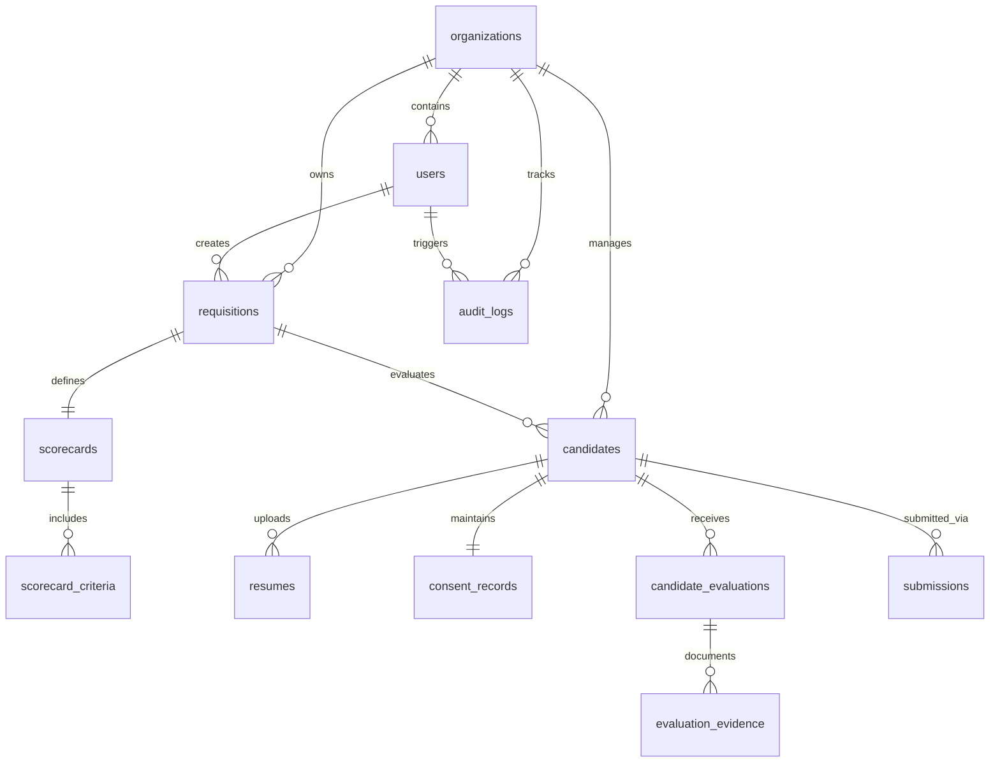

# ShortlistAI — Database Architecture, Integrity & Migration Audit Report

**Audit Date:** November 8, 2026  
**Database Engine:** PostgreSQL 15.19 (Debian 15.19-1) on Port 5434  
**Driver:** Asyncpg 0.29.0 via SQLAlchemy 2.0.36 Async Engine  
**Migration Tool:** Alembic 1.14.0  
**Auditor Role:** Senior Database Architect & Backend Lead  

---

## 1. Database Schema & Relational Integrity

The ShortlistAI database implements 12 relational tables adhering to Third Normal Form (3NF) with strict foreign key constraints and cascade rules:

### 1.1 Relational Integrity Checks
1. **Primary Keys:** Every table utilizes UUID v4 primary keys (`uuid.UUID`), preventing sequential enumeration and ensuring distributed generation safety.
2. **Foreign Keys & Cascades:**
   - Deleting a `Requisition` cascades to associated `Scorecard` and `ScorecardCriteria`.
   - Deleting an `Evaluation` cascades to its `EvaluationEvidence` records.
   - Candidate deletion triggers controlled anonymization rather than unchecked database-level deletion cascades, ensuring audit trail immutability.
3. **Unique Constraints:**
   - `users(email)`: Enforces unique email addresses across the system.
   - `consent_records(verification_token)`: Guarantees single-use candidate consent links.
   - `scorecards(requisition_id, version)`: Enforces unique version numbers per requisition.

---

## 2. Multi-Tenant Logical Isolation

- **Tenant Scoping:** Every core entity (`User`, `Requisition`, `Candidate`, `Resume`, `Submission`, `ConsentRecord`, `AuditLog`) maintains an immutable foreign key reference to `organizations.id`.
- **Database Enforcement:** Repository queries automatically inject tenant scoping (`WHERE organization_id = :tenant_id`), ensuring data belonging to Agency A is never returned in queries executed by Agency B.
- **Client Boundaries:** Client hiring managers belong to an organization with `org_type = 'CLIENT'`. They can only query `Submission` records explicitly linked to their `client_organization_id`.

---

## 3. Alembic Migration Ledger Audit

The migration chain was inspected and verified using `alembic current` and `alembic history`:

| Revision ID | Description / Scope | Dependency | Status |
| :--- | :--- | :--- | :---: |
| `8df96264c8b2` | Initial schema: organizations, users, requisitions | `<base>` | **APPLIED** |
| `0998f7a5da05` | Phase 3: Scorecards, criteria categories, weights, knockouts | `8df96264c8b2` | **APPLIED** |
| `3e089431a456` | Phase 4: Candidates, resumes, upload batches, deduplication | `0998f7a5da05` | **APPLIED** |
| `4f19b52a7c81` | Phase 5: Candidate evaluations, evidence citations, scoring | `3e089431a456` | **APPLIED** |
| `5e81f129bb32` | Phase 6: Recruiter reviews, internal notes, candidate status | `4f19b52a7c81` | **APPLIED** |
| `6f92a341cc43` | Phase 7: Client submissions, 9-stage pipeline, masking | `5e81f129bb32` | **APPLIED** |
| `7a01c382dd94` | Phase 8: Consent records, data requests, deletion requests, audit logs | `6f92a341cc43` | **APPLIED (HEAD)** |

**Current Database Revision:** `7a01c382dd94`  
**Migration Chain Health:** Linear, unbroken, 0 merge heads, 0 pending migrations.

---

## 4. Connection Pooling & Query Performance

### 4.1 Connection Pool Settings (`backend/app/db/session.py`)
- **`DB_POOL_SIZE`:** 20 (base connections allocated to the application pool).
- **`DB_MAX_OVERFLOW`:** 10 (additional burst connections permitted during traffic spikes).
- **`DB_POOL_RECYCLE`:** 1,800 seconds (recycles idle connections every 30 minutes to prevent stale socket dropouts).

### 4.2 Indexing Strategy
- B-tree indexes are declared on all high-frequency query paths:
  - `candidates(organization_id, status)`
  - `requisitions(organization_id, status)`
  - `submissions(client_organization_id, pipeline_stage)`
  - `audit_logs(organization_id, timestamp)`
  - `resumes(candidate_id, parse_status)`

---

## 5. Database Audit Verdict

The relational database architecture is sound, fully normalized, multi-tenant scoped, properly indexed, and completely synchronized with the Alembic migration chain.

**Database Audit Status: PASS (Clean, Normalized, and Verified)**
